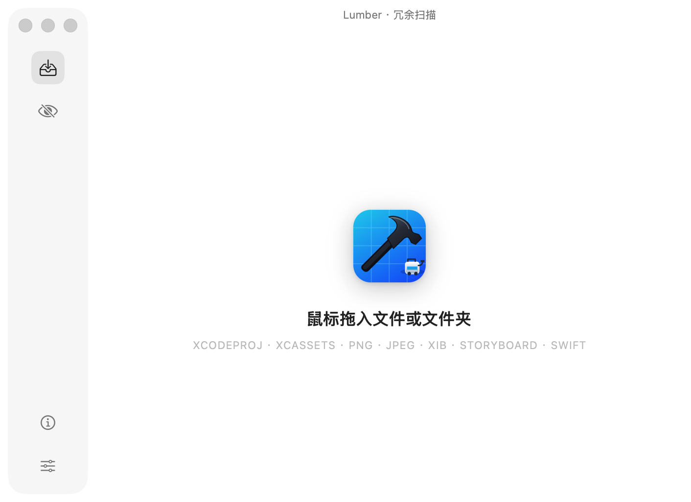

# Lumber

<p align="center">
  
</p>

<p align="center">
  <strong>Xcode 工程冗余资源清理工具</strong><br>
  <sub>macOS 原生 · SwiftUI · 零依赖 · 本机扫描，不上传代码</sub>
</p>

<p align="center">
  
  <a href="https://github.com/kaiser143/Lumber/actions/workflows/ci.yml"></a>
  
  
  
</p>

<p align="center">
  
</p>

把 `.xcodeproj` / `.xcworkspace` 拖进窗口，Lumber 会找出工程里**没有被引用的图片、颜色、数据集、XIB / Storyboard、代码文件**等资源，支持预览、忽略、多选、导出报告，确认后一键移入废纸篓。

解析与引用判定全部由自研 Swift 完成，不依赖 Xcode 命令行工具；默认只进废纸篓可恢复，可选同步清理 `project.pbxproj`（写回前备份为 `.lumber-bak`）。

---

## 特性

### 扫描

- **拖放即用**：拖入工程、workspace 或目录；非法文件仅红框提示，不弹窗
- **多工程选择**：自动排除 Pods、Carthage 等依赖工程
- **自研 pbxproj 解析**：文件引用、folder reference、Xcode 16 同步文件夹、`PBXVariantGroup`、构建阶段与 Info.plist
- **Assets 聚合**：`imageset` / `colorset` / `dataset` 等按资源名判定，而不是逐张图片
- **流畅可取消**：两阶段异步扫描，实时进度；不写缓存、不落盘

### 判定（宁漏勿删）

| 结果 | 含义 |
| --- | --- |
| 已引用 | 出现在 pbxproj、构建阶段、Info.plist 或工程文本中 |
| 未加入 target | 在工程导航器里，但未进入任何构建阶段（通常是漏配） |
| 待确认 | 仅出现在注释、拼接或部分匹配中，需人工判断 |
| 高置信度未引用 | 工程里完全找不到该名称，且未被 target 引用 |

另有整目录保护（蓝色文件夹 / 同步文件夹按「可能运行时按路径读取」处理），并区分代码与注释、`@2x/@3x` 与驼峰变体。

### 清理与导出

- **安全删除**：统一走系统废纸篓；批量删除需确认
- **可选清理 pbxproj**：删除时同步移除引用，写回前备份 `.lumber-bak`
- **忽略规则**：兼容 `.gitignore` 常用子集，可导入，规则持久化
- **导出 CSV**：当前筛选结果导出（UTF-8 with BOM，Excel / Numbers 可直接打开）

### 体验

- **结果列表**：类型 / 判定状态筛选、搜索、排序、缩略图、Finder 定位、键盘导航
- **单例预览窗口**：图片自适应缩放旋转；代码 / XIB 文本预览；`← →` 切换，`空格 / Esc` 关闭
- **记住偏好**：扫描深度、是否扫代码、清理 pbxproj 等会持久化；首页展示最近工程

---

## 环境要求

- macOS 26.0+
- Xcode 26 / Swift 6（`swift-tools-version:5.9`）
- 无第三方依赖

---

## 快速开始

```bash
git clone https://github.com/kaiser143/Lumber.git
cd Lumber
swift run Lumber
```

发布构建：

```bash
swift build -c release   # 产物：.build/release/Lumber
```

也可以 `open Package.swift` 用 Xcode 开发。

首次扫描其他目录若提示无权限，请在 **系统设置 › 隐私与安全性 › 完全磁盘访问权限** 中放行。

---

## 使用方式

1. 拖入或选择 `.xcodeproj` / `.xcworkspace`，等待扫描完成（多工程时先选择）
2. 按类型或判定状态筛选、搜索、排序；行内可直接看到判定原因
3. 单击选中，`⌘` 多选，`Shift` 区间选择；双击 / 空格预览，确认后忽略或移入废纸篓
4. 长期跳过的路径，到忽略规则页添加规则（或导入 `.gitignore`）后重新扫描
5. 需要留档时，从右上角菜单导出当前筛选结果为 CSV

**常用快捷键**

| 快捷键 | 作用 |
| --- | --- |
| `⌘O` | 打开工程 |
| `⌘R` | 重新扫描 |
| `⌘F` | 搜索 |
| `⌘A` | 全选 |
| `⌘E` | 导出报告 |
| `空格` / `回车` | 预览（列表） |
| `Delete` | 删除 |
| `←` `→` | 预览窗口切换资源 |
| `空格` / `Esc` | 关闭预览 |

---

## 命令行参数

| 参数 | 说明 |
| --- | --- |
| `--open <路径>` | 启动后直接扫描指定工程或目录 |
| `--inspect <路径>` | 不开窗口，打印解析与扫描摘要后退出 |
| `--mock` | 使用内置演示数据，模拟扫描，不读写磁盘 |
| `--demo=results` | 直接进入结果列表（Mock 数据） |
| `--demo=preview` | 进入结果列表并打开预览窗口 |
| `--demo=scanning` | 进入扫描中状态 |
| `--demo=rules` | 进入忽略规则页 |
| `--demo=settings` | 进入设置页 |
| `--demo=about` | 进入关于页 |

```bash
swift run Lumber --open ~/Develop/DemoApp
swift run Lumber --inspect ~/Develop/DemoApp/DemoApp.xcodeproj
swift run Lumber --inspect ~/Develop/DemoApp/DemoApp.xcworkspace
```

---

## 忽略规则

规则保存在 `~/Library/Application Support/Lumber/ignore_rules`，每行一条：

```
Pods/            # 任意层级的目录
*.md             # 任意层级的文件
Debug/*.png      # 相对工程根目录
/build/          # 根锚定
!keep.png        # 取反，后写优先
```

与 git 一致：父目录被忽略后，无法再用 `!` 取回其中的文件。

扫描还会跳过 `Pods`、`Carthage`、`DerivedData`、`build`、`node_modules`、`fastlane` 等目录，以及 `.xcodeproj`、`.xcframework`、`.bundle`、`.app` 等包。

---

## 项目结构

```
Sources/Lumber/
├── App/            入口、全局状态、外壳与主题
├── Core/
│   ├── Models/     资源与工程数据模型
│   ├── Parsing/    pbxproj、Assets、Info.plist 解析
│   ├── Services/   扫描引擎、引用判定、预览、废纸篓、CSV、pbxproj 清理
│   ├── Ignore/     忽略规则匹配与持久化
│   └── Mocks/      演示数据
└── Features/       首页、扫描、结果、预览、规则、设置、关于、多工程选择
Tests/LumberTests/  解析 / 忽略 / 判定 / 导出 / 清理单元测试
```

---

## 测试

```bash
swift test
```

覆盖 pbxproj 解析、忽略规则、引用判定、Assets 解析、工程选择、CSV 导出、pbxproj 清理等。CI 见 [`.github/workflows/ci.yml`](.github/workflows/ci.yml)。

---

## 已知限制

- 静态文本匹配：运行时拼接的资源名只能归为「待确认」或漏报
- 只解析 pbxproj 的第一个 `rootObject`，不递归嵌套子工程
- 同步文件夹按「自动加入 target」处理，不区分 exception set
- 不解析 `.xcconfig`；写在 xcconfig 里的 `INFOPLIST_FILE` / `ASSETCATALOG_COMPILER_*` 读不到
- 不扫描 SPM `.swiftpm` 资源包
- 单文件索引上限 1.5MB、单个 token 上限 96 字符，预览文本上限 400KB
- 清理 pbxproj 只移除路径精确匹配的引用，不删空组；Assets 内 imageset、同步文件夹散落文件通常会跳过

---

## 许可

仓库暂未附带许可证。如需开源分发，请补充 `LICENSE`。
